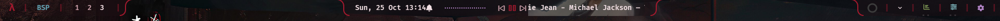

# Rangalipi — Windows Rice & Apple HIG Design System

.png)

A bespoke, production-grade Windows desktop environment combining:
- **Tiling Window Manager**: [Komorebi](https://github.com/LGUG2Z/komorebi) with fluid animations and clean ignore rules
- **Global Hotkey Layer**: [GlazeWM](https://github.com/glzr-io/glazewm) running flash-free via `silent-run`
- **Status Bar**: [YASB](https://github.com/amnweb/yasb) with CSS-driven frosted acrylic glass, icon-only active window/stack displays, and Cava audio spectrum synchronization
- **Custom Native Widgets**: Pure Rust Win32 layered acrylic widgets designed to Apple Human Interface Guidelines (HIG) and WidgetKit principles

---

## 📸 Desktop Showcase & Gallery

The desktop environment adapts across 21 handcrafted Rangalipi themes with theme-synchronized Cava spectrum visuals, dynamic acrylic panels, and media overlays:

| Japanese Demon Scroll (Dark Theme) | Hummingbird Rice (Matcha Light Theme) |
|---|---|
| .png) | .png) |

| Firewatch Blue Mountain (Night Theme) | Earth Orbit (Cava Spectrum Active) |
|---|---|
| .png) | .png) |

| Media Player Popup (Lyrics & Audio Spectrum) | Demon Scroll with Active Media |
|---|---|
| .png) | .png) |

### Bar Precision Views

| Rangalipi Wine Dark |
|---|
|  |

| Rangalipi Wine Light (High Contrast) |
|---|
|  |

---

## 📁 Repository & Folder Organization

The repository and deployed bar directory are cleanly structured into dedicated folders:

```
Rangalipi/
├── assets/                        # Graphic assets & motifs
│   ├── mandala/                   # Processed mandala PNGs
│   ├── motifs/                    # Handcrafted SVG motifs & runners
│   └── raw-art/                   # Raw vector source files (.ai, .eps, .jpg)
├── configs/                       # Window manager configurations
│   ├── glazewm/config.yaml        # GlazeWM global hotkey layer
│   └── komorebi/                  # Komorebi tiling engine rules & startup
├── docs/                          # Installation & replication guides
├── screenshot/                    # High-resolution desktop showcase screenshots
├── tools/                         # Companion Win32/Rust tools & scripts
│   ├── chrome/yasb-chrome/        # Shared acrylic canvas & DWM blur library
│   ├── keybind/                   # Apple HIG cheatsheet menu (Win+K)
│   ├── komorebi-sync/             # Window manager workspace title synchronizer
│   ├── picker/palette-picker/     # 21-theme palette switcher
│   ├── pomodoro/                  # Focus timer state machine
│   ├── saka/                      # Vedic Panchang astronomical engine
│   ├── saka-popup/                # Dual hero moons & telescopic night sky panel
│   ├── screen-shot/               # Layered window screen capture (CAPTUREBLT)
│   ├── setup/                     # One-shot replication script (yasb-setup.ps1)
│   └── theme/yasb-theme/          # Theme switcher engine & silent-run shim
├── config.yaml                    # Active YASB bar configuration
├── styles.css                     # Active theme stylesheet
├── DESIGN.md                      # Apple HIG visual design contract
├── rangalipi-options.css          # Optional widget styling presets
└── yasb_colors.css                # Color variables reference
```

---

## 🌟 Component Architecture

All companion tools are built in **pure Rust** (zero Python, zero Qt, zero webview overhead) organized in a unified Cargo workspace:

### 1. 🌸 Vedic Panchangam & Lunar Portal (`tools/saka` & `tools/saka-popup`)
*Documentation: [`tools/saka-popup/saka-popup.md`](tools/saka-popup/saka-popup.md) & [`tools/saka/saka.md`](tools/saka/saka.md)*
- **Dual Hero Moons**:
  - **3D Rotating Moon (Left)**: Physical 3D spherical rendering with dynamic terminator shading.
  - **Authentic Telescopic Night Sky View (Right)**: True Earth-facing astronomical telescope portal featuring real selenographic geography (*Mare Imbrium*, *Oceanus Procellarum*, *Mare Serenitatis*, *Mare Tranquillitatis*, *Mare Crisium*, *Mare Nubium*), highland crater ray systems (*Tycho*, *Copernicus*, *Kepler*), forward-scattering atmospheric corona, and a 24-star celestial starfield.
- **Three Desktop Layout Modes** (Press `M` to cycle):
  - **Portrait** ($760\text{px} \times 920\text{px}$): Dual hero moons, dedicated Udaya Tithi and Day Duration clearance bands, solar timeline, and 11 full-width attribute rows with progress bars.
  - **Landscape** ($1140\text{px} \times 622\text{px}$): Dual-card layout with solar metrics on the left and a two-column panchangam grid on the right.
  - **Compact** ($680\text{px} \times 502\text{px}$): Desktop glance widget with responsive 2×2 flex chip matrices (Nakshatra, Yoga, Karana, Vara) and elevated Day Duration pill with 12px vertical clearance over the solar progress track.
- **Bilingual Typographic Engine**: Press `Tab` to switch between English and native Telugu scripts.

### 2. 🎨 Apple HIG Palette Switcher (`tools/picker/palette-picker`)
*Documentation: [`tools/picker/picker.md`](tools/picker/picker.md)*
- Frameless, topmost Win32 layered acrylic window.
- Instant access to all **21 Rangalipi themes** (11 dark + 10 light) with real-time fuzzy filter input, swatch previews, and keyboard/mouse navigation.
- Switches active themes atomically with zero restart required, synchronizing Cava audio spectrum gradients and Pomodoro colors.

### 3. ⌨️ Keybindings Cheatsheet Menu (`tools/keybind`)
*Documentation: [`tools/keybind/keybind.md`](tools/keybind/keybind.md)*
- Accessible via **`Win + K`** or by clicking the keyboard widget in the bar.
- Interactive category filtering chips (`All`, `WM Focus`, `WM Move`, `Layout`, `Workspaces`, `Apps`, `System`) and fuzzy search.
- Smooth keyboard and mouse-wheel scrolling with custom scrollbar drawing.

### 4. 🚀 Zero-Flash Launcher (`silent-run`)
- Spawns console programs (`komorebic`, scripts) with `CREATE_NO_WINDOW` (`0x08000000`) so hotkeys execute with zero visible console window flash.

### 5. ⏳ Focus Timer (`tools/pomodoro`)
*Documentation: [`tools/pomodoro/pomodoro.md`](tools/pomodoro/pomodoro.md)*
- Discrete pomodoro state engine and bar readout with persistent work/break cycle tracking.

### 6. 🪟 Window Manager Layers (`configs/`)
*Documentation: [`configs/README.md`](configs/README.md)*
- **GlazeWM**: Global hotkey layer (`Alt`-based movement and window focus).
- **Komorebi**: Tiling engine with smooth animations, custom theme borders, and clean ignore rules.

---

## 🚀 Quick Replication Guide

For full installation prerequisites and details, see [`docs/INSTALL.md`](docs/INSTALL.md).

### 1. Install Fonts
```powershell
scoop bucket add nerd-fonts
scoop install nerd-fonts/JetBrainsMono-NF nerd-fonts/FiraCode-NF nerd-fonts/FiraCode-NF-Mono
```

### 2. Clone & Run Replicator
```powershell
git clone https://github.com/harish2222/Rangalipi.git C:\Users\$env:USERNAME\Rangalipi
cd C:\Users\$env:USERNAME\Rangalipi
powershell -NoProfile -ExecutionPolicy Bypass -File tools\setup\yasb-setup.ps1
```

The script automatically:
- Backs up your existing configs with timestamped `.bak` extensions.
- Installs Rust via winget if missing.
- Builds the entire Rust workspace (`cargo build --workspace --release`).
- Adapts configuration paths to your current user profile.
- Deploys the bar, assets, GlazeWM hotkey layer, and Komorebi tiling engine.
- Verifies the full chain with automated smoke tests.

### 3. Launch
1. Start YASB: `yasb`
2. Start GlazeWM and Komorebi: `alt+shift+r`
3. In a new PowerShell session, use `yt list` or `yt set <theme>`.

---

## ⌨️ Essential Hotkeys

| Shortcut | Action |
|---|---|
| **Win + K** | Open Keybindings Cheatsheet |
| **Alt + h / j / k / l** | Focus Left / Down / Up / Right window |
| **Alt + Shift + h / j / k / l** | Move focused window Left / Down / Up / Right |
| **Alt + Return** | Launch terminal |
| **Alt + Shift + b** / **Alt + z** | Launch browser |
| **Alt + o** | Launch editor |
| **Alt + q** | Close window |
| **Alt + f** | Toggle maximize |
| **Alt + Shift + f** | Toggle monocle layout |
| **Alt + r** | Resize mode (arrow keys / hjkl to adjust, Escape to exit) |
| **Alt + Shift + r** | Reload GlazeWM & Komorebi configurations |
